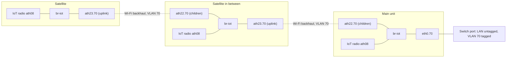

# Architecture

Everything here was observed on a Deco BE63 V2.6 (Qualcomm IPQ5332, QSDK on OpenWrt 23.05,
kernel 5.4.213) with firmware 1.3.5 Build 26071712, in access point mode, on a mesh with
wireless backhaul. Interface names are the ones that firmware uses.

## Getting in

Every Deco listens on TCP port 20001 with a Dropbear SSH server. It accepts the owner of the
network. The user name is the SHA-1 of the TP-Link ID e-mail address, in hex. The password is
the TP-Link ID password.

There is no shell. The session allows one thing, a TCP forward to `127.0.0.1:20002` on the Deco,
where `tmpsvr` listens. `tmpsvr` is the service behind the Deco app. It takes numbered requests
("opcodes") with a JSON body and runs the matching handler as root. Its framing is described in
[`src/deco_vlan/tmp.py`](../src/deco_vlan/tmp.py).

Two handlers are enough to do anything.

| Opcode | Body | Effect |
|---|---|---|
| `0x00F0` | `{"params": {"file": path}}` | returns the file's contents, binary files included |
| `0xC456` | `{"params": {"file": path, "content": text}}` | writes the file and always answers success |

The second handler never reports a failure, so deco-vlan reads every file back after writing it.

`tmpsvr` holds a table of all its opcodes, 612 on this firmware. The app's setting for automatic
firmware updates is among them (`0x427E` to read, `0x427F` to write), and
`deco-vlan auto-update` uses it.

After 10 rejected logins a unit refuses logins for two hours, so deco-vlan stops at the first
rejection instead of trying the next unit.

### Host keys

The server presents a 2048-bit RSA key that is identical on all units, and an ECDSA key that the
unit generates at boot and keeps in RAM. The RSA key only signs with SHA-1, which current SSH
libraries refuse, so deco-vlan pins the ECDSA key. That key changes at every reboot, and the
README says how that is handled.

### Finding the other units

Every unit keeps the list of mesh members in `/tmp/sync-server/mesh_dev_list`, with the
address, role, model and firmware of each. deco-vlan reads it from the unit it was pointed at.

## Running commands

No handler runs a command as such. A command injection has been reported in another handler,
and deco-vlan does not use it. It uses cron in four steps.

1. It writes a small polling script to `/tmp/deco-vlan-runner.sh`.
2. It appends one line to `/etc/crontabs/root` that starts the script, and it writes `root` to
   `/etc/crontabs/cron.update` so that `crond` loads the file again.
3. It waits until `crond` has loaded the file and reached the next full minute, which takes up
   to two minutes.
4. It removes the line again.

The script then waits for a file with commands, runs it, and leaves the output in another file.
`/tmp` and `/etc` are in RAM on a Deco, so none of this survives a reboot. The script exits when
it has been idle for ten minutes.

## How a Deco mesh moves traffic

Each unit has one bridge that matters, `br-lan`. All client radios are members.

| Network | Radios | Section type in the `wireless` configuration |
|---|---|---|
| main | `ath0`, `ath1`, `ath2` (2.4, 5, 6 GHz) | `lan` |
| IoT | `ath08`, `ath18` | `iot` |
| guest | `ath01`, `ath11`, `ath21`, and `ath07`, `ath17` for open networks | `guest`, `owe_guest` |

A radio exists only while its network is switched on for its band.

Neither extra network gets a VLAN in access point mode. For the IoT network the setting
`iot_wifi.iot.vlan_enable` exists but does nothing. The code that would act on it is commented
out in `/etc/init.d/iot_network`, and the helper it would call is not shipped. For the guest
network the firmware's VLAN (591 by default) is for router mode only. `set_guest_vlan` in
`/lib/guest-eth/guest-vlan.sh` returns at once in access point mode.

### Guests

Two things keep guests apart in the stock firmware. Their radios run with `ap_isolate=1`, so
clients of one radio cannot reach each other. And `hyfi_bridging` puts the guest radios in a
class of their own, which is the `class` column of `hyctl show`. TP-Link describes the effect as
guests being allowed to talk to the gateway only. The app calls the switch for this "Allow Local
Access", and the setting is `wifi.guest.host_isolation`.

### Backhaul

The radios that connect Decos to each other are not in the bridge directly. Their VLAN 1
sub-interfaces are.

| Interface | Direction |
|---|---|
| `ath02.1`, `ath12.1`, `ath22.1` | access point side, towards child units (2.4, 5, 6 GHz) |
| `ath03.1`, `ath13.1`, `ath23.1` | station side, towards the parent unit, on satellites only |

So LAN traffic crosses the air between Decos as 802.1Q frames with VLAN 1. Frames with another
VLAN ID cross the same links untouched, with nothing to enable.

A satellite is usually associated to its parent on more than one band at the same time. Bridging
two links to the same neighbour would loop, so a kernel module from Qualcomm, `hyfi_bridging`,
takes over forwarding for `br-lan`. `hyctl show` prints its view.

    interfaces  iftype  type     grp_num  bcast
    ath23.1     6g      norelay  0        enable
    ath13.1     5g      norelay  0        disable
    ath03.1     2.4g    norelay  0        disable
    ath22.1     6g      relay    1        enable

`norelay` marks the links towards the parent, and `relay` marks the links towards children. Of
the links towards the parent exactly one has `bcast enable`. That one is the uplink the mesh is
using right now. It changes when a link drops or the mesh picks a better one.

### Ethernet

The four ports hang off a built-in switch (QCA "MHT", driven with `ssdk_sh`). Towards the CPU
every port has its own VLAN. Port 1 arrives as `eth0.1`, port 2 as `eth0.2`, port 3 as `eth1.3`
and port 4 as `eth1.4`, and those four are the bridge members. The switch works in `SECURE`
mode. A frame that arrives with a tag is dropped unless that VLAN exists in the switch's table
with the port as a member.

`hyctl show` lists the four ports too, all of type `relay`. That is so on the main unit as
well, where the gateway is behind one of them.

## What deco-vlan adds

For each network that is given a VLAN ID, every unit gets three things.

- The network gets a bridge of its own, `br-iot` or `br-guest`. The bridge has no IP address and
  IPv6 is switched off, so the Deco itself is not a host in that network.
- The network's radios move from `br-lan` into that bridge.
- The links to the rest of the mesh get the VLAN, and the tagged interfaces become members of
  the bridge. A link is a backhaul radio, with `<radio>.<VLAN>`, or the Ethernet port a cable
  is in.

The picture shows the IoT network with VLAN 70. The guest network is the same with its own
bridge and VLAN.

### Towards children

A unit adds the VLAN on all of its `relay` radios. Which band a child uses is the child's
choice.

A child on a cable that is plugged into this unit, instead of into a switch, is not handled.
The VLAN is not let through to that port, so the child's two networks have no path.

### The uplink

Every unit has exactly one uplink per network. This is the loop protection. The new bridges
are plain Linux bridges without `hyfi_bridging`, so they must never have two paths to the same
neighbour. With one uplink per unit the bridges of the mesh form a tree.

The uplink of a satellite is the link `hyctl` shows as `norelay` with `bcast enable`. On
wireless backhaul that is a radio. When the mesh changes it, deco-vlan moves the VLAN to the
new radio, and it takes the old member out before it puts the new one in. In a test the 6 GHz
link of a satellite was taken down, the mesh switched to 2.4 GHz, and the IoT VLAN followed
within 3 seconds. The same happened on the way back.

On a cable it is an Ethernet port. The mesh software then lists that port as `norelay` with
`bcast enable`, and it drops the radios towards the parent from the list.

    interfaces  iftype  type     grp_num  bcast
    ath22.1     6g      relay    1        enable
    eth1.4      eth     norelay  0        enable
    eth1.3      eth     relay    1        enable

When a satellite was plugged into a switch, this showed 9 seconds after the link came up, and
deco-vlan moved both VLANs to the port within the same second.

The main unit has no such link, because it has no parent. Its uplink is the Ethernet port
behind which the default gateway's MAC address was learned in `br-lan`. Any unit without a
marked uplink is treated this way.

While no uplink is known, the members stay as they are. The radios stay in their bridges and
the devices on them have no network until an uplink returns.

### Through the Ethernet switch

An uplink on an Ethernet port needs the VLAN in the built-in switch. Take `eth0.1`, which is
switch port 1 behind CPU port 5. deco-vlan creates the VLAN in the switch with those two ports
as tagged members, and it adds `eth0.<VLAN>` to the bridge. These commands do the same by hand.

    ssdk_sh vlan entry create 70
    ssdk_sh vlan member add 70 1 tagged
    ssdk_sh vlan member add 70 5 tagged
    vconfig add eth0 70
    brctl addif br-iot eth0.70

Port numbers are read from the switch's own table. When the uplink moves to a radio, the VLAN
is removed from the switch again.

### Clients

When a radio changes bridge, the devices on it still hold addresses from the old network.
deco-vlan disconnects them with `hostapd_cli deauthenticate`, which makes most devices ask for
an address again. A DHCP server that is authoritative answers a request for the old address with
a refusal, and the device starts over. `hostapd` on this firmware is not told which bridge a
radio is in, so moving the radio does not disturb the WPA handshake.

### Guest isolation

The stock filter that confines guests belongs to `br-lan`, so it is gone once the guest radios
are in `br-guest`. deco-vlan replaces it with a feature of the Linux bridge. A port can be
marked isolated in `/sys/class/net/<port>/brport/isolated`, and the bridge does not forward
between two isolated ports. Every member of `br-guest` is isolated except the one towards
upstream. A guest's frames can therefore only travel up, unit by unit, to the router, and frames
from the router travel down to every guest. Two guests never see each other, whether they are on
one Deco or on two. The radios keep `ap_isolate=1` as well.

The flag follows `wifi.guest.host_isolation`. With "Allow Local Access" switched on in the app,
no port of `br-guest` is isolated. The members of `br-iot` are never isolated, since IoT devices
commonly need to reach each other.

All of this happens inside the Decos. Two Decos on cables meet in the switch they are plugged
into, and so do their guests. A frame from a guest on one Deco reaches the other through its
uplink port, which is not isolated. If guests on different wired Decos must be kept apart, the
switch has to do it for the guest VLAN.

## Keeping it in place

The stock firmware does not know about any of this and undoes it now and then. A Wi-Fi reload
can recreate the radios and put them back into `br-lan`. A network reload removes interfaces it
did not create and may reset the switch table.

So the script does not configure once. It runs as a watcher (`deco-vlan.sh watch`) that makes
one pass per second. A pass reads `hyctl` and files under `/sys`, and changes something only
where the state is not the wanted one. The radios come first in every pass, before any uplink
work. The Ethernet switch is looked at when the uplink changes and every 30 seconds, and so is
the port a cable is in. If `hyctl` prints nothing, the last view of the links stands. With both
networks the watcher used about 1 % of the CPU. A radio pushed back into `br-lan` by hand was
out again in under 3 seconds.

A network that is switched off has no radios. Its bridge and VLAN are kept ready, and the radios
are claimed in the first pass in which they exist.

The watcher writes its state to `/tmp/deco-vlan.status` whenever it changes and at least every
30 seconds. The first line is about the watcher itself and carries the unit's uptime and the
watcher's version. One line per network follows. `deco-vlan status` reads that file and the
uptime, which needs no command to be run on the unit. A unit that runs an older watcher than the
installer shows up there.

    version=0.3.0 pid=2167 uptime=1000.50 state=active role=RE mode=AP uplink=ath23
    network=iot vlan=70 isolated=0 radios=ath08 members=ath02.70,ath08,ath12.70,ath22.70,ath23.70
    network=guest vlan=80 isolated=1 radios=ath01,ath11 members=ath01,ath02.80,ath11,ath23.80

In router mode the watcher does nothing and removes what it built.

## Surviving a reboot

A Deco's root file system is a read-only squashfs. `/etc` is a RAM disk that is filled at boot,
and the settings in `/etc/config` are restored from an encrypted file on a small writable
partition, `/tp_data/user_data` (UBIFS). The stock firmware executes nothing from that
partition.

One stock mechanism runs a file named in the saved settings, and that is the firewall. OpenWrt's
firewall configuration can contain a section like this one.

    config include 'deco_vlan'
        option path '/tp_data/user_data/deco-vlan/boot.sh'

The firewall start-up (`/lib/firewall/core_init.sh`, `fw_load_include`) sources every such file
that exists, at boot and at each firewall reload. `/etc/config/firewall` is part of the settings
the firmware saves with `saveconfig` and restores at boot.

Install therefore does three things on each unit.

1. It copies `deco-vlan.sh`, `boot.sh` and `config` to `/tp_data/user_data/deco-vlan/`.
2. It adds the include section with `uci`, commits, and calls the firmware's own `saveconfig`.
3. It starts the watcher.

`boot.sh` is one line that starts the watcher in the background, and the watcher does nothing if
one is already running. Being sourced again at every firewall reload is therefore harmless.

At boot the firewall starts after the Wi-Fi scripts have been launched. In the reboot that was
measured it still started 30 seconds before the IoT radio existed. The watcher claims a radio in
the first pass in which it sees it.

Installing again with other VLAN IDs builds on what is there. A network whose ID stays the same
is taken over as it stands. A network whose ID changes, or that loses its ID, is taken down
first by the installation that built it, so its devices ask for new addresses.

Uninstall removes the section, saves, and deletes the directory. A factory reset does the same
by wiping the saved settings. A firmware update may or may not keep them.

## What it relies on

For anyone trying another model or firmware, these are the assumptions, in the order in which
they are likely to break.

1. Port 20001 accepts the TP-Link ID and forwards to `tmpsvr`, and opcodes `0x00F0` and `0xC456`
   exist. `deco-vlan read HOST /proc/version` checks this.
2. `/tmp/sync-server/mesh_dev_list` and `/tmp/work_mode` exist. The latter says
   `"work_mode":"FAP"` on the main unit and `"RE"` on satellites.
3. `crond` runs with `/etc/crontabs`.
4. The radios of a network are the `wireless` UCI sections of type `iot`, `guest` and
   `owe_guest`, named like the interface.
5. `hyctl show` lists the backhaul radios as `<radio>.<vlan>` and the Ethernet ports as
   `eth<n>.<port>`, with the columns shown above.
6. `vconfig`, `brctl` and `hostapd_cli` exist, with control sockets in
   `/var/run/hostapd-<radio device>`. The kernel's bridge ports have the `isolated` flag, which
   needs Linux 4.18 or newer.
7. On a unit on a cable `ssdk_sh vlan entry show` prints `[vid]`, `[tagged_member]` and
   `[untagged_member]` masks, and each Ethernet port has its own VLAN towards the CPU.
8. `/etc/config/firewall` supports `config include` and is saved by `saveconfig`, and
   `/tp_data/user_data` is writable.

`deco-vlan run` and `deco-vlan read` are there to check each of these on a new model before
installing anything.

Points 4, 5 and 7 are the watcher's parsers, and they are tested against output captured from a
real unit, in [`tests/fixtures`](../tests/fixtures). To port to another model or firmware,
capture the same commands there, add them as fixtures, and let the tests say what no longer
matches.
